<div align="center">

# 🏘️ Villa Celeste OS '98

### Learn Spanish inside a 1998 computer full of neighbourhood gossip.

**60 lessons · A1 → B1+ · free · no install · works on your phone**

<a href="https://nowhereman-in-galaxy.github.io/villa-celeste-os/"></a>


[English](#english) · [中文说明](#中文说明)

<br />

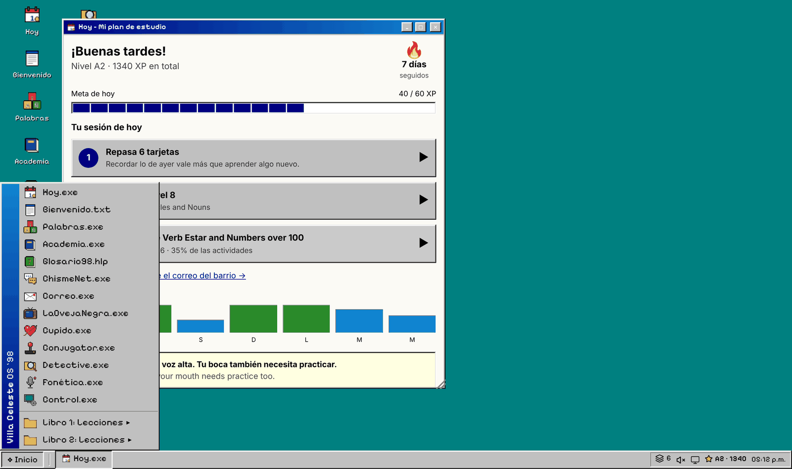

</div>

---

## English

You switch on an old computer and find yourself on the intranet of **Villa Celeste**, a Latin American neighbourhood. Five families live there. A dentist is house-hunting and allergic to carpets, a teenager got caught texting during an exam, and two neighbours never miss their telenovela. Everything they write is in Spanish, so the more you learn, the more you understand.

Under the soap opera is a complete course. It follows the 60 lessons of *Learning Spanish I & II* (Bill Worden and Laura Rojas-Arce), from *hola* all the way to the subjunctive.

### ☀️ Every day starts with a plan

Open the site and **Hoy** ("today") tells you what to do. It lists three short steps: review the cards that are due, play the next vocabulary level, then continue your lesson. A streak counter and a daily goal help you come back tomorrow.

<div align="center">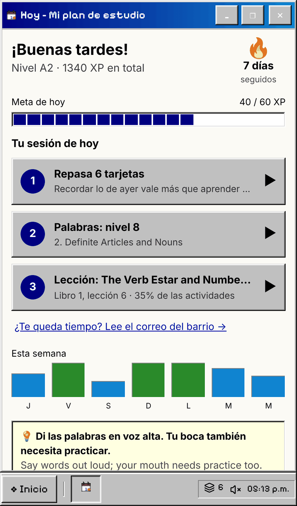&nbsp;&nbsp;&nbsp;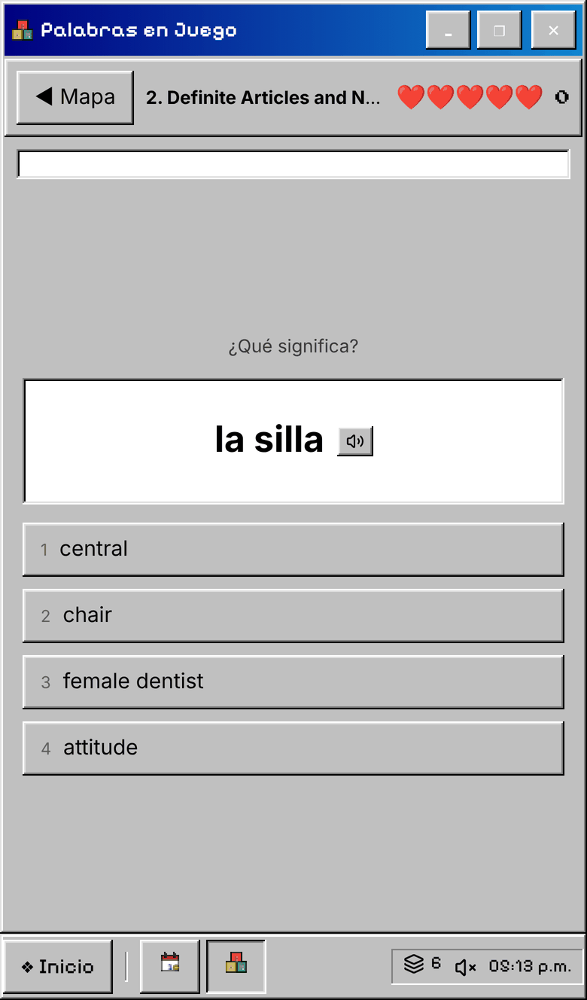</div>

### 🎮 Learn every word by playing

**Palabras** turns each lesson's vocabulary into short levels of eight words.

1. **Study:** flip through the cards and tap one to hear it.
2. **Play:** answer a mix of rounds. You pick the meaning, pick the Spanish, choose by ear, match pairs, and spell words with letter tiles.
3. **Score:** you have five lives. Every word you miss comes back later in the level and goes into your review deck. Finish with up to three stars.

<table>
<tr>
<td width="50%">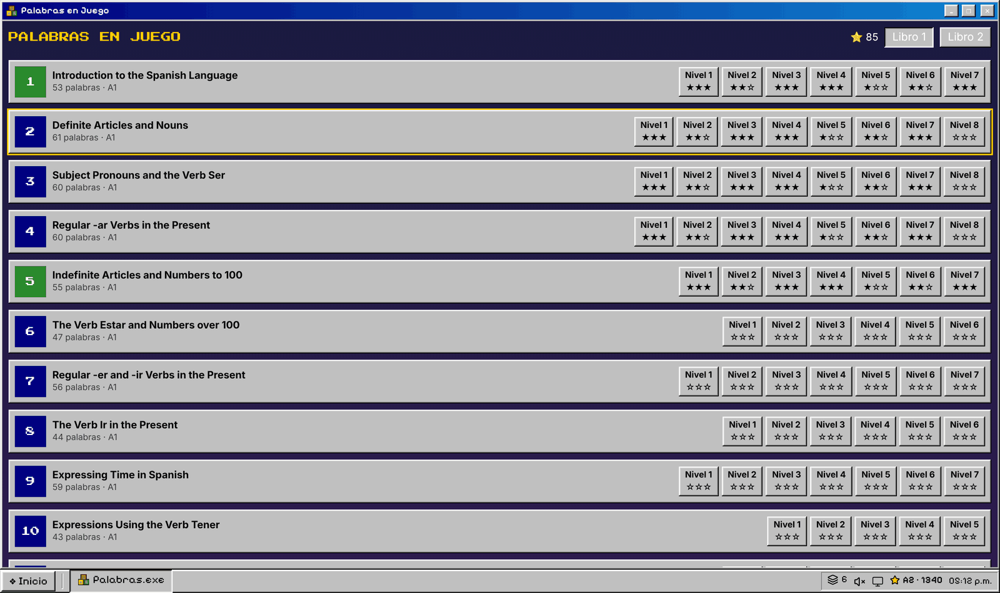</td>
<td width="50%">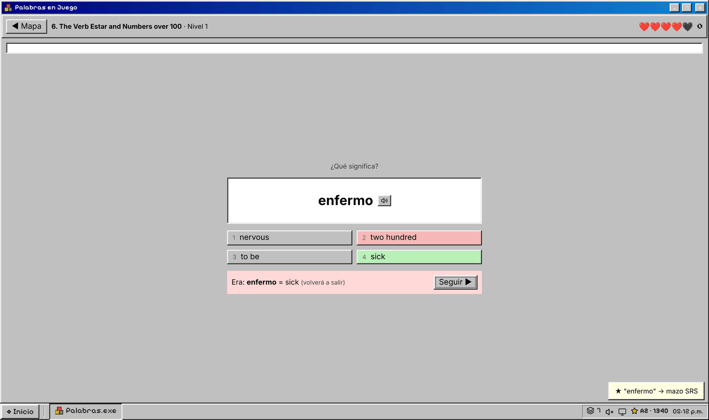</td>
</tr>
<tr>
<td align="center"><sub>Each lesson has its own row of levels.</sub></td>
<td align="center"><sub>Wrong answers show the right one straight away.</sub></td>
</tr>
</table>

### 📋 Find your level in five minutes

Already know some Spanish? **Test** is an adaptive vocabulary check over the course's 2,260 words. Questions get harder or easier as you answer, and there is an honest *No lo sé* button so you don't have to guess. At the end you get:

- an estimate of how many words you know, and your level;
- the lesson to start from, with every earlier lesson unlocked in Palabras;
- the words you missed, ready to add to your review deck.

Take it again every few weeks to see your vocabulary grow.

### 📖 The whole textbook, made interactive

**Academia** holds all 60 lessons, open from day one, and each lesson has four steps:

1. **Words:** listen to each word, normal or slow.
2. **Grammar:** the explanation as readable text, with the conjugation tables kept intact.
3. **Practice:** the book's exercises with the blanks turned into answer boxes. They are checked against the book's answer key. If you get one wrong, the correct answer appears next to it. A yellow box means you only missed an accent.
4. **Read & speak:** cultural readings with quizzes, plus speaking practice.

<table>
<tr>
<td width="50%">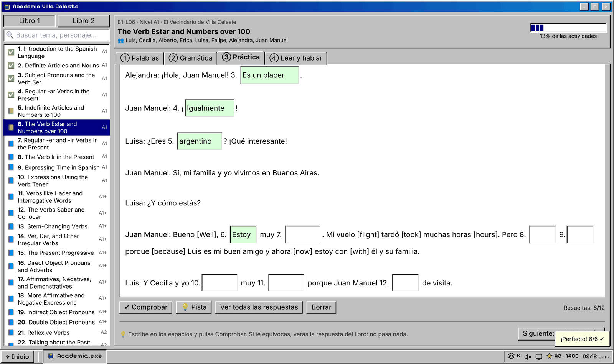</td>
<td width="50%">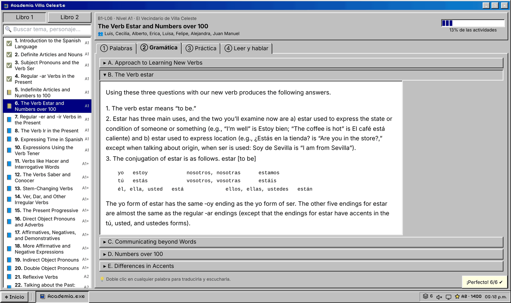</td>
</tr>
</table>

### 🗂️ Remember it next week

Star any word anywhere and it goes into your deck in **Glosario**. A spaced-repetition scheduler shows each card again just before you'd forget it. Glosario is also a full dictionary of about 5,900 entries: you can search by topic, cognate, Spanish→English or English→Spanish, and read a grammar reference for both books.

> 💡 **Double-click any Spanish word, in any window**, to hear it, see its meaning and save it.

<div align="center">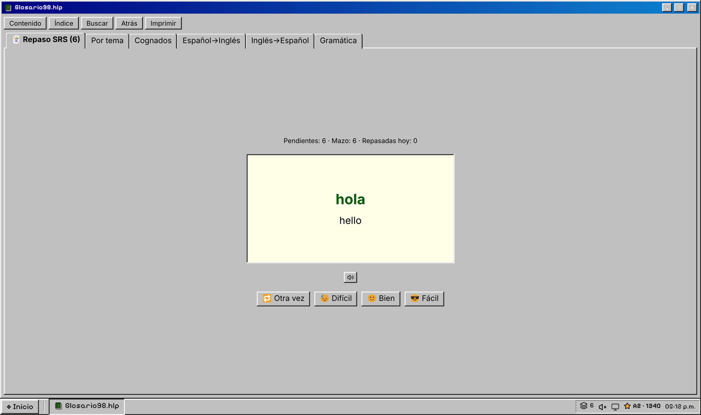</div>

### 🏘️ Then go and meet the neighbours

These story apps practise the same grammar, but in context:

| | |
|---|---|
| 💬 **ChismeNet** | Instant-messenger chats with the neighbours. Pick the grammatically correct reply to keep the gossip flowing. |
| 📧 **Correo** | 22 emails, including doctor's orders, travel tickets and school notices, each with comprehension questions. |
| 📺 **La Oveja Negra** | A melodramatic telenovela with Spanish and English subtitles. In *Director mode* the scene freezes until you choose the right line. |
| 💘 **Cupido** | Find Andrés a date who isn't a disaster, and find Alberto a house without carpets. |
| ⚡ **Conjugator** | An arcade game where verbs fall from the sky and you conjugate them before they land, across 11 tenses. Includes *por/para* and *ser/estar* duels. |
| 🕵️ **Detective** | A neighbourhood map and a corkboard of 29 characters. Their secrets unlock as your level grows. |
| 🎙️ **Fonética** | Pronunciation drills and tongue twisters. Your browser listens to you and scores your pronunciation. |

<table>
<tr>
<td width="33%">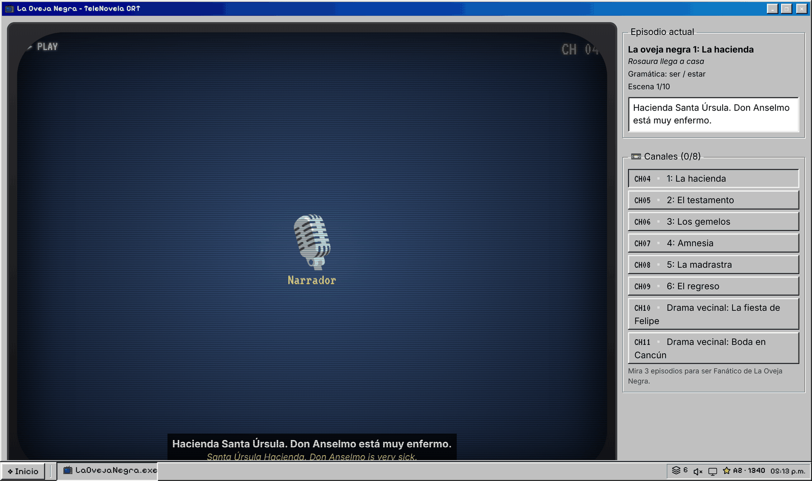</td>
<td width="33%">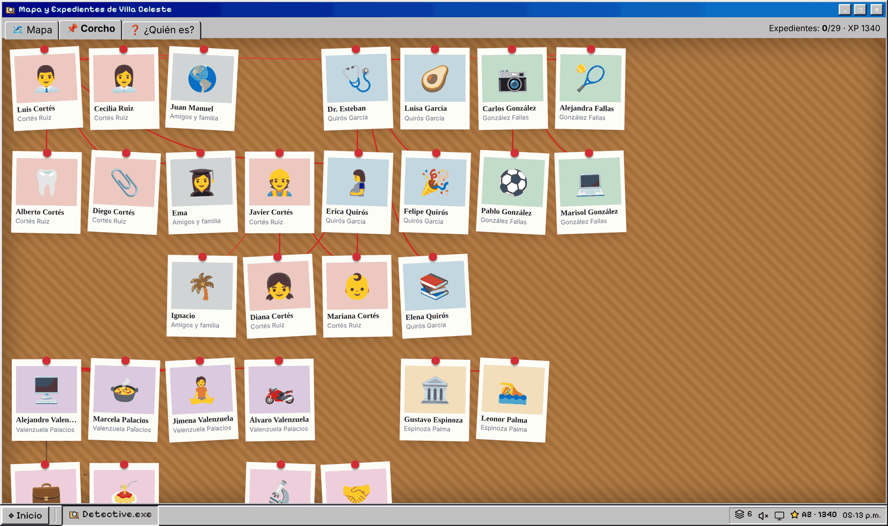</td>
<td width="33%">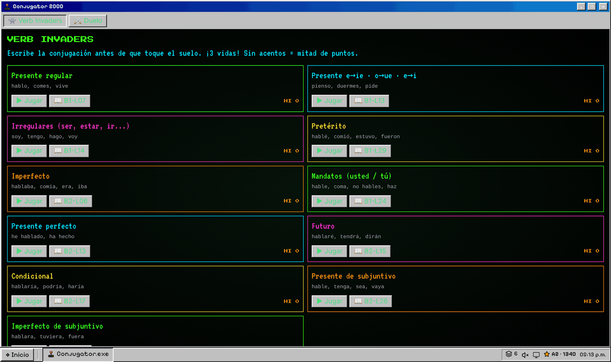</td>
</tr>
</table>

### Good to know

- **Comfortable or fully retro:** the desktop is pixel art, and inside the apps the text stays easy to read. For full immersion, switch on *Modo píxel* from Hoy or Control.
- **Audio:** listening and speaking use your browser's built-in voices, so Chrome or Edge works best. If you hear no Spanish, install a Spanish voice in your system settings.
- **Your progress** stays in this browser. To move it to another device, export it from **Control → Datos** and import it there.

### Run it yourself

```bash
npm install
npm run dev      # local dev server
npm run build    # static site in dist/, host it anywhere
```

Built with React, TypeScript and Vite. The sound effects are generated live with the Web Audio API, so there are no audio files and no backend.

---

## 中文说明

<div align="center">

**在一台 1998 年的电脑里学西班牙语。60 课，从 A1 到 B1+，免费、不用安装、手机也能用。**

<a href="https://nowhereman-in-galaxy.github.io/villa-celeste-os/"></a>

</div>

打开一台老电脑，你接入了拉美小区 **Villa Celeste** 的社区内网。这里住着五户人家：对地毯过敏、一直在找房子的牙医，考试时偷偷发短信被抓的高中生，每天准时追肥皂剧的两位邻居……他们写的一切都是西班牙语，你学得越多，就看懂得越多。

故事背后是一整套课程，对应教材 *Learning Spanish I & II*（Bill Worden、Laura Rojas-Arce）的 60 课，从 *hola* 一直学到虚拟式。

**☀️ 每天打开就知道做什么。** 首页「Hoy」会给你三步：先复习到期的单词卡，再玩下一关单词，最后接着学课本。还有连续打卡天数和每日目标。

**🎮 单词闯关。** 「Palabras」把每课单词分成 8 个一关。先看一遍、听一遍，然后进入混合题型：选意思、选西语、听音辨词、连线配对、字母拼写。一共 5 条命，最多 3 颗星，答错的词会在本关再出现，并自动加进复习卡。

**📋 五分钟测出词汇量。** 「Test」是自适应的单词测试，覆盖课程里的 2,260 个词，题目会根据你的回答变难或变简单，不会的词直接点「No lo sé」，不用瞎猜。测完会告诉你大约认识多少个词、处于什么水平、该从哪一课开始，并在 Palabras 里自动解锁之前的课；没答出来的词可以一键加入复习卡。隔几周再测一次，就能看到自己的进步。

**📖 整本课本，可以互动。** 「Academia」的 60 课全部开放，每课按「单词 → 语法 → 练习 → 阅读和口语」四步走。练习题按课本答案批改：答错会直接显示标准答案，输入框变黄表示只错了重音符号。

**🗂️ 学过的不忘掉。** 在任何地方点 ★ 收藏的单词，都会进入「Glosario」的间隔重复复习。它同时也是一本约 5,900 词条的词典，附两本书的语法速查。在任何窗口**双击西语单词**，就能听发音、看释义、一键收藏。

**🏘️ 去认识邻居。** 这些故事程序练的是同样的语法，只是放进了故事里：
- **ChismeNet**：聊天八卦，选出语法正确的回复。
- **Correo**：22 封邮件，每封都有阅读理解题。
- **La Oveja Negra**：带双语字幕的肥皂剧。
- **Cupido**：帮 Andrés 相亲，帮 Alberto 找没有地毯的房子。
- **Conjugator**：动词变位街机游戏。
- **Detective**：小区地图和人物关系墙。
- **Fonética**：发音练习，浏览器会听你说话并打分。

**小贴士：**
- **界面：** 桌面是像素风，程序里默认用好读的字体；想要全像素的沉浸感，在 Hoy 或 Control 里打开 *Modo píxel*。
- **语音：** 朗读和语音识别用浏览器自带的语音，推荐 Chrome 或 Edge。
- **进度：** 只保存在当前浏览器里；换设备时，在「Control → Datos」导出、再导入存档。
